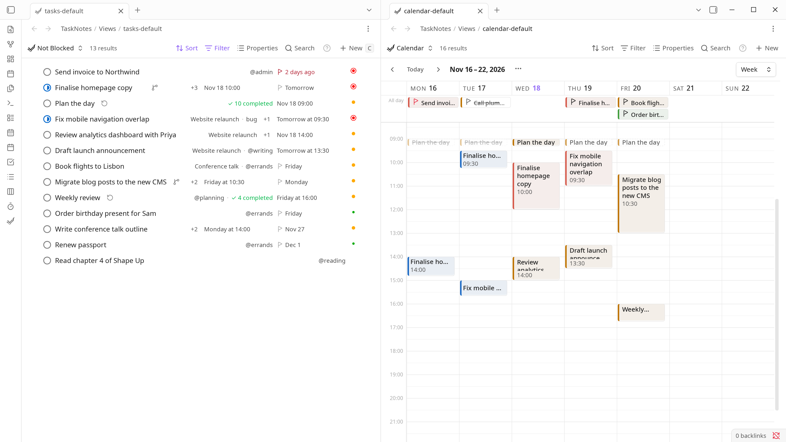
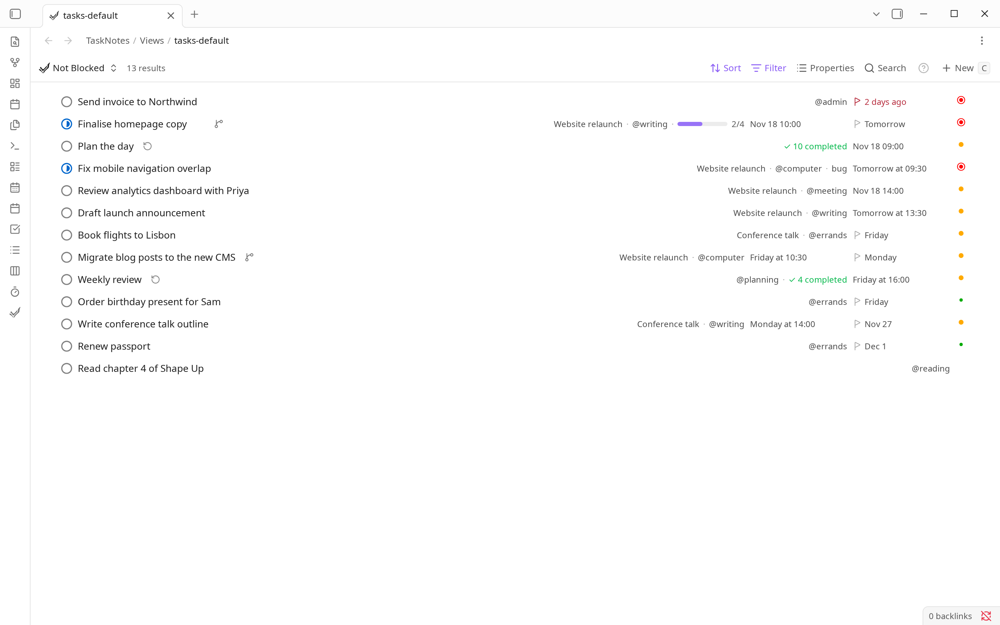
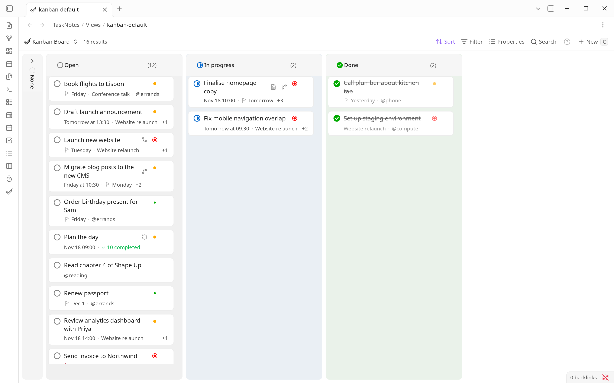
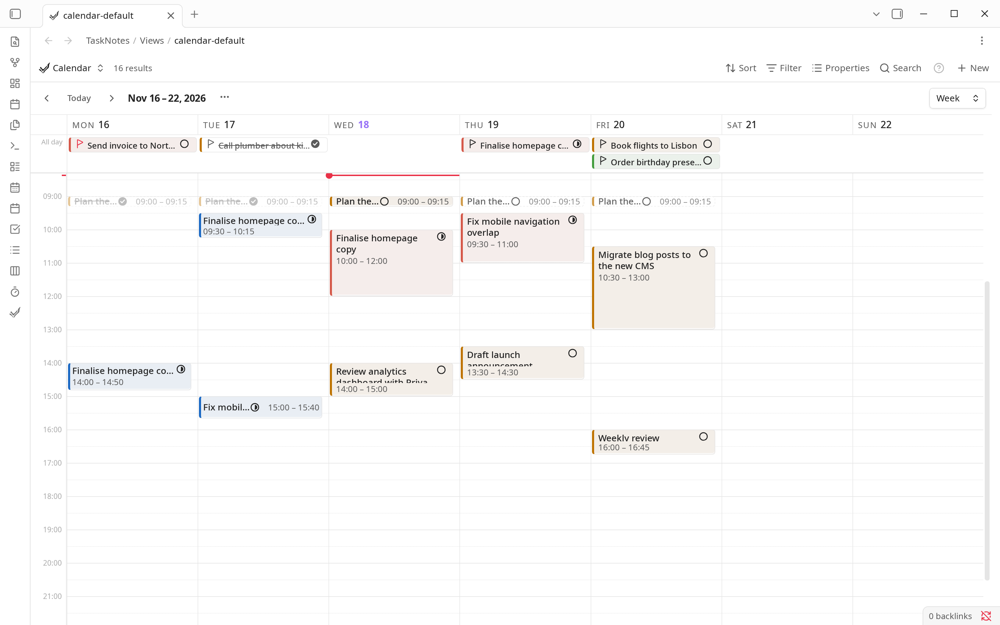
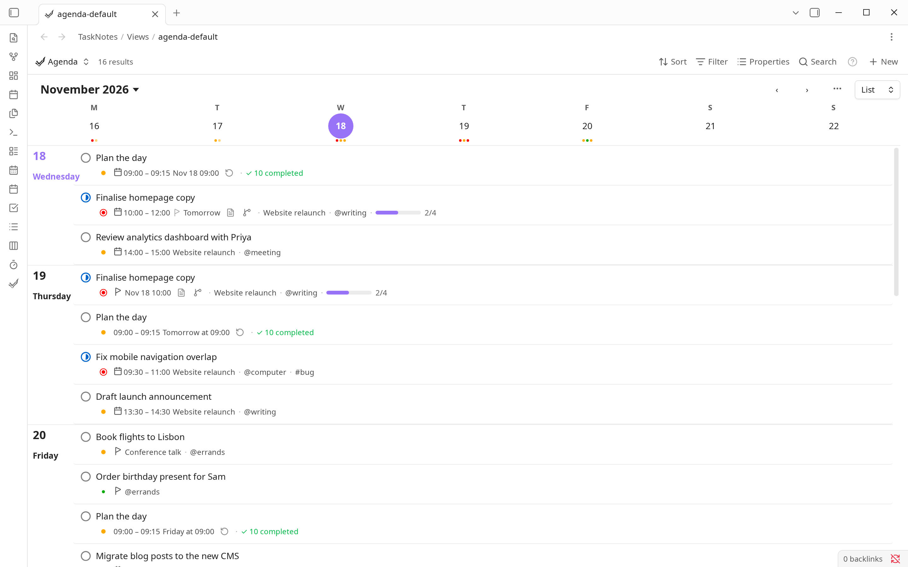
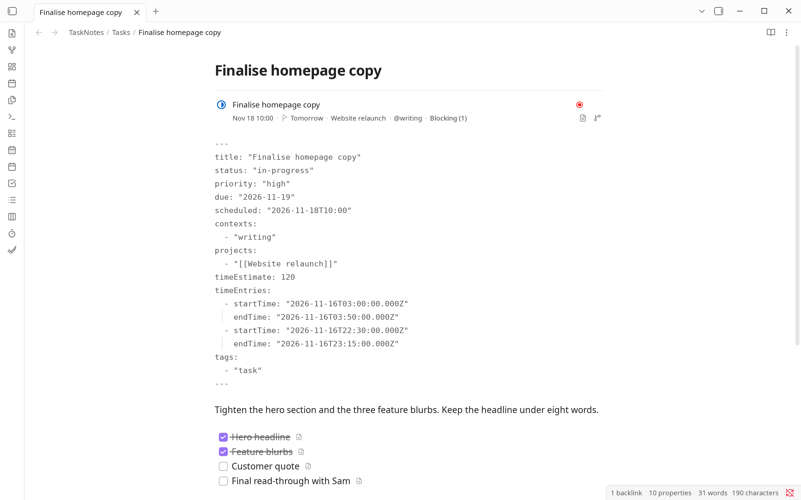
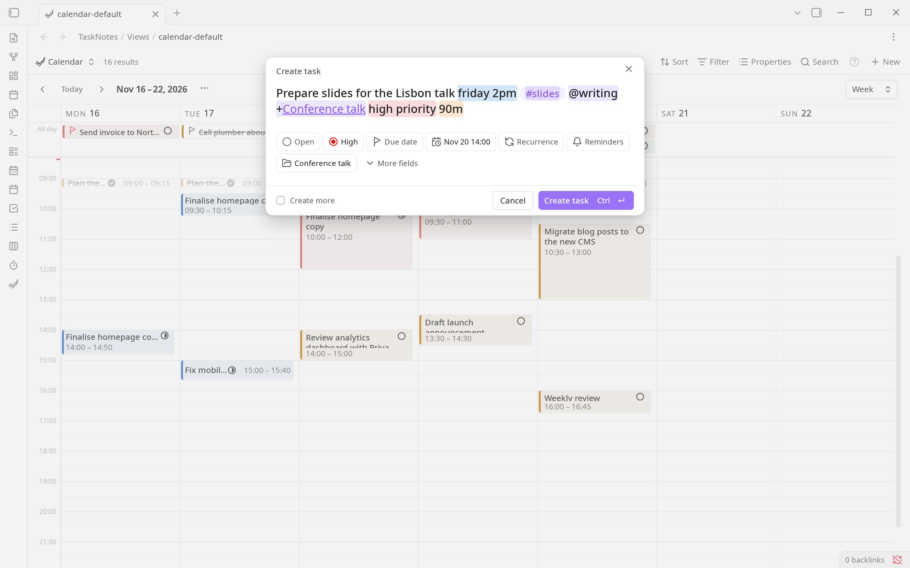

#  TaskNotes for Obsidian

A task management plugin for Obsidian. Each task is a separate Markdown note, and the task list, Kanban, calendar and agenda views are [Obsidian Bases](https://help.obsidian.md/bases) views.

<picture>
  <source media="(prefers-color-scheme: dark)" srcset="https://raw.githubusercontent.com/callumalpass/tasknotes/main/media/readme/hero-dark.png">
  
</picture>

Documentation: [tasknotes.dev](https://tasknotes.dev/)

> [!NOTE]
> **TaskNotes is also available in Beta on the web, iPhone and Android.** [Open TaskNotes on the web](https://app.tasknotes.dev/), [download it from the App Store](https://apps.apple.com/app/tasknotes/id6797168033) or [get it on Google Play](https://play.google.com/store/apps/details?id=dev.tasknotes.app). To use it with the tasks in your vault, sync the vault with [mdbase Connect](https://mdbase.dev/downloads/), which needs an mdbase Connect account. See [Use TaskNotes App with your vault](https://tasknotes.dev/guides/tasknotes-app/).

## Overview

Each task is a Markdown note. Its status, dates, projects and other properties are stored in YAML frontmatter, and the rest of the note is ordinary Markdown.

The views are `.base` files in `TaskNotes/Views/`. You can change their filters, sorting and grouping in the Bases UI, edit the files directly, or copy them to make new views.

There is no separate database, so other tools and scripts can read and edit tasks. Property names are configurable, and extra frontmatter fields you add to tasks can be used in Bases.

## Views

<table>
  <tr>
    <td width="50%">
      <picture>
        <source media="(prefers-color-scheme: dark)" srcset="https://raw.githubusercontent.com/callumalpass/tasknotes/main/media/readme/task-list-dark.png">
        
      </picture>
      <p><b>Task List</b>. The default file includes Today, Inbox, Overdue, This Week and Not Blocked views.</p>
    </td>
    <td width="50%">
      <picture>
        <source media="(prefers-color-scheme: dark)" srcset="https://raw.githubusercontent.com/callumalpass/tasknotes/main/media/readme/kanban-dark.png">
        
      </picture>
      <p><b>Kanban</b>. Columns can be grouped by status or any other property, with optional swimlanes.</p>
    </td>
  </tr>
  <tr>
    <td width="50%">
      <picture>
        <source media="(prefers-color-scheme: dark)" srcset="https://raw.githubusercontent.com/callumalpass/tasknotes/main/media/readme/calendar-dark.png">
        
      </picture>
      <p><b>Calendar</b>. Shows scheduled and due tasks, recurring instances, tracked time, timeblocks and calendar subscriptions. Tasks can be dragged to reschedule them.</p>
    </td>
    <td width="50%">
      <picture>
        <source media="(prefers-color-scheme: dark)" srcset="https://raw.githubusercontent.com/callumalpass/tasknotes/main/media/readme/agenda-dark.png">
        
      </picture>
      <p><b>Agenda</b>. Scheduled and due tasks, listed by day.</p>
    </td>
  </tr>
</table>

There are also mini calendar, Pomodoro and relationships views.

## Task notes

<picture>
  <source media="(prefers-color-scheme: dark)" srcset="https://raw.githubusercontent.com/callumalpass/tasknotes/main/media/readme/task-note-dark.png">
  
</picture>

TaskNotes reads and writes the frontmatter. The task card above it can be turned off in settings.

Recurring tasks use RRULE strings with per-instance completion tracking:

```yaml
title: "Weekly review"
recurrence: "DTSTART:20261016;FREQ=WEEKLY;BYDAY=FR"
complete_instances: ["2026-11-06", "2026-11-13"]
```

An individual occurrence can also be given its own note. See [recurring tasks](https://tasknotes.dev/features/recurring-tasks/).

## Natural language input

<picture>
  <source media="(prefers-color-scheme: dark)" srcset="https://raw.githubusercontent.com/callumalpass/tasknotes/main/media/readme/create-task-dark.png">
  
</picture>

The create task dialog parses dates, times, recurrence, `#tags`, `@contexts`, `+projects`, priority, status and time estimates from the text, and highlights the parts it recognised. Checkboxes (`- [ ]`) in notes can also be converted to tasks.

## Other features

- Calendar sync with Google Calendar and Microsoft Outlook, and read-only ICS subscriptions
- Time tracking per task, a Pomodoro timer and session history
- Recurring tasks with fixed or flexible schedules and per-instance completion
- Dependencies between tasks
- Reminders, relative to due or scheduled dates or at a fixed time
- Custom statuses, priorities and fields
- Task link overlays, which show a linked task's status, priority and dates in the editor

## How it works with Bases

TaskNotes registers its view types with Bases: `tasknotesTaskList`, `tasknotesKanban`, `tasknotesCalendar` and `tasknotesMiniCalendar`. Task notes are the rows, and their frontmatter properties are the columns.

The default `.base` files include formulas that can be used for sorting, filtering, grouping or as columns:

```yaml
formulas:
  priorityWeight: if(priority=="none",0,if(priority=="low",1,if(priority=="normal",2,if(priority=="high",3,-1))))
  daysUntilDue: if((due.isEmpty() == false), ((number(date(due)) - number(today())) / 86400000).floor(), null)
  isOverdue: (due.isEmpty() == false) && date(due) < today() && status != "done"
  isRecurring: recurrence && !recurrence.isEmpty()
```

See [default base templates](https://tasknotes.dev/views/default-base-templates/) for the full list.

## Getting started

1. Install **TaskNotes** from **Settings → Community plugins** and enable it. TaskNotes needs Obsidian 1.13.1 or later.
2. Make sure the **Bases** core plugin is enabled under **Settings → Core plugins**.
3. Create a task with **TaskNotes: Create new task**. Open views with **TaskNotes: Open tasks view**, **Open Kanban board**, **Open calendar view** or **Open agenda view**.

For a vault that already has task notes, see [Adopt TaskNotes in an existing vault](https://tasknotes.dev/getting-started/existing-vault/). For upgrading from v4, see the [upgrade guide](https://tasknotes.dev/migration-v4-to-v5/).

## Integrations

TaskNotes has an optional HTTP API, and webhooks can notify other services when tasks change. There is a [browser extension](https://github.com/callumalpass/tasknotes-browser-extension) and a [CLI](https://github.com/callumalpass/tasknotes-cli). See the [HTTP API](https://tasknotes.dev/HTTP_API/), [webhooks](https://tasknotes.dev/webhooks/) and [JavaScript API](https://tasknotes.dev/javascript-api/) docs.

## Language support

Interface: English, German, Spanish, French, Italian, Japanese, Korean, Portuguese, Russian and Chinese.

Natural language parsing: English, German, Spanish, French, Italian, Japanese, Dutch, Portuguese, Russian, Swedish, Ukrainian and Chinese.

## License

MIT. See [LICENSE](LICENSE).
