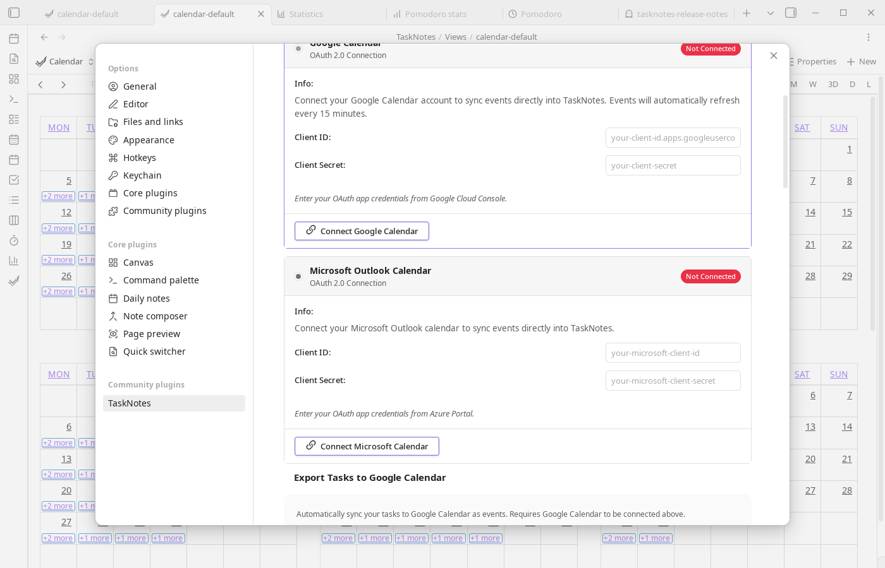

# Calendar Integration Setup

TaskNotes shows Google Calendar and Microsoft Calendar events beside your tasks. Google Calendar can be connected in two ways: by signing in with Google, or with your own OAuth credentials. Microsoft Calendar uses your own OAuth credentials.

## Sign in with Google

Signing in with Google needs no Google Cloud project.

1. Open `Settings -> TaskNotes -> Calendars & integrations -> Google Calendar`.
2. Select **Sign in with Google**. Google's sign-in page opens in your browser.
3. Sign in. The browser then shows an eight-character code.
4. Enter the code in Obsidian. Your browser opens once more, this time to ask for access to Google Calendar.

TaskNotes then shows your primary calendar and the calendars that are ticked in Google Calendar, up to five at a time. Choose which are shown under **Calendars shown**.

- Events are read through the TaskNotes Calendar service, from about two months back to four months ahead. They are held in memory while Obsidian is open. They are not saved in your vault, and the service does not store them. See the [privacy policy](privacy.md#tasknotes-calendar-hosted-service).
- Events refresh every 30 minutes while Obsidian is on screen, when you return to Obsidian after that long, and when you select **Refresh calendar events**.
- You can create events, and move, edit and delete events, on calendars you can write to. Calendars shared with you as read-only are shown but cannot be changed.
- Exporting tasks and timeblocks to Google Calendar is not available when you sign in with Google. It needs your own OAuth credentials, described below. Task events you exported earlier appear as ordinary events.
- Each device signs in separately. **Sign out on this device** leaves your other devices signed in. Under **Access and account**, **Disconnect Google Calendar** withdraws access on every device, and **Delete calendar service account** also removes what the service holds about you.
- TaskNotes uses one Google connection at a time. Disconnect your own Google application before signing in with Google, and sign out before connecting your own.

## Setup (Your Own OAuth Credentials)

To connect Microsoft Calendar, or to connect Google Calendar without the TaskNotes Calendar service, create OAuth credentials with the provider and paste them into TaskNotes settings. The sections below walk through each provider.



### Google Calendar

<iframe width="560" height="315" src="https://www.youtube.com/embed/DzMN1Wu2P-g?start=210" title="How to set up Google Calendar OAuth" frameborder="0" allow="accelerometer; autoplay; clipboard-write; encrypted-media; gyroscope; picture-in-picture" allowfullscreen></iframe>

*Video by [@antoneheyward](https://www.youtube.com/@antoneheyward)*

In [Google Cloud Console](https://console.cloud.google.com), create or select a project, enable the Google Calendar API, and create OAuth 2.0 credentials using the Desktop application type. Then copy the Client ID and Client Secret into TaskNotes (`Settings -> TaskNotes -> Calendars & integrations -> Google Calendar -> Use your own Google application`) and select **Connect Google Calendar**.

If your Google OAuth app is still in testing mode, add the Google account you will connect with under **Google Auth Platform -> Audience -> Test users**. Otherwise Google may block sign-in with a 403 `access_denied` error saying the app has not completed verification.

### Microsoft Calendar

In [Azure Portal](https://portal.azure.com), create an App Registration for your Microsoft account type. TaskNotes currently uses Microsoft's `common` OAuth authority, so the app registration must allow the account type you plan to connect through that authority. Tenant-specific single-tenant authorities are not configurable yet.

Under **Authentication**, add the **Mobile and desktop applications** platform and add this redirect URI:

```text
http://localhost
```

Also turn on **Allow public client flows**. TaskNotes uses a local loopback callback with a dynamic port, which Microsoft matches against the registered loopback URI.

If Azure does not accept the loopback redirect URI through the normal UI, configure loopback redirect support in the manifest by adding:

```json
{
  "url": "http://127.0.0.1",
  "type": "Web"
}
```

Next, add delegated Microsoft Graph API permissions (`Calendars.Read`, `Calendars.ReadWrite`, and `offline_access`) and grant consent when required by your organization. Copy the Application (client) ID into TaskNotes, then click **Connect Microsoft Calendar**. The client secret field can be left blank for public-client desktop setup.

## Security Notes

These notes apply to your own OAuth credentials. When you sign in with Google instead, Google's tokens stay with the TaskNotes Calendar service, and Obsidian Secret Storage holds only this device's session with that service.

OAuth client IDs, client secrets, and account tokens are stored locally in Obsidian Secret Storage, which is encrypted at rest when supported by the operating system. They are not written to TaskNotes' `data.json`. Tokens refresh automatically, calendar data syncs directly between your vault and provider, and you can disconnect at any time to revoke account access.

Secret Storage is local to the Obsidian installation and vault. When setting up TaskNotes on another device, enter the OAuth app credentials and connect the calendar again. After disconnecting, use **Forget saved credentials** if you also want to remove the client ID and client secret.

## Troubleshooting

**"Failed to connect"**

Verify credentials first, then confirm loopback redirect configuration. TaskNotes uses a local callback on `127.0.0.1` with a dynamically selected port. For Microsoft, ensure loopback redirect support is configured in the app registration. Also confirm required permissions/scopes are granted.

For Google 403 `access_denied` errors during sign-in, confirm the account is listed as a test user in the Google Auth Platform audience settings while your OAuth app is in testing mode.

**Google `400 redirect_uri_mismatch`**

Check that the credentials entered in TaskNotes belong to an OAuth client of type **Desktop app**, not **Web application**. TaskNotes uses `http://127.0.0.1:<port>` and the operating system chooses the port for each connection attempt. A Web application client configured with a fixed `8080` redirect may work for one attempt but is not compatible with this dynamic-port setup. A `flowName` query parameter is not part of TaskNotes' callback URI and should not be added as a required redirect.

If a Desktop app client still fails, report your TaskNotes and Obsidian versions, operating system, client application type, and only the `redirect_uri` from Google's error details. Do not post the full authorization URL, client secret, authorization code, state, tokens, or exported settings. Adding a test user addresses testing-mode `403 access_denied`, not a redirect mismatch.

**"Failed to fetch events"**

Disconnect and reconnect to refresh OAuth tokens, then re-check provider-side calendar permissions.

**Connection lost after Obsidian restart**

Tokens should persist between sessions. If reconnection is required each restart, check whether Obsidian Secret Storage is available and retaining secrets for the vault.
