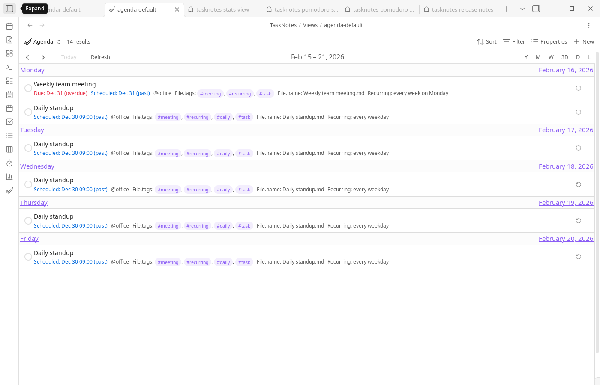

# Agenda View


The Agenda view is a dedicated `.base` file that opens the calendar in list mode. It provides a scrollable agenda of upcoming and overdue tasks, notes, and external calendar events without needing to switch the primary calendar into list view manually.



## File Location

- Default file: `TaskNotes/Views/agenda-default.base`
- Command: **Open Agenda View** (ribbon icon and command palette)
- Configure the file path in **Settings → TaskNotes → Appearance & interaction → Views & base files**

TaskNotes creates missing default `.base` files automatically on startup when **Auto-create default files** is enabled. You can replace the command path with your own `.base` file if you maintain multiple agendas.

## Default Configuration

The stock agenda file renders the calendar in `listWeek` mode:

```yaml
views:
  - type: tasknotesCalendar
    name: "Agenda"
    calendarView: "listWeek"
    listDayCount: 7
    startDateProperty: file.ctime
    titleProperty: file.basename
    showPropertyBasedEvents: false
    showOverdueOnToday: true
    order:
      - note.status
      - note.priority
      - note.due
      - formula.dueIn
      - note.scheduled
```

This configuration displays seven days at a time, derives entries from `file.ctime`/`file.basename`, shows overdue scheduled or due tasks on today's row, shows the generated `Due in` countdown next to due dates, and inherits the same display options (show scheduled/due/recurring/timeblocks/time entries/ICS events) as the primary calendar view.

## Customization

Edit the `.base` file to tailor the agenda:

- Change `calendarView` to `listDay` or `listMonth` for different spans
- Adjust `listDayCount` for shorter or longer agendas; the Bases option supports up to 365 days
- Set `showOverdueOnToday: false` if you want the list to show only events that fall inside the current date window
- Add `filters` to focus on specific projects, tags, or statuses
- Modify `order` to control which task properties appear in the row layout
- Turn on **Hide top-level subtasks** (`hideTopLevelSubtasks: true`) to drop a subtask's own row on days its parent task is also listed; the subtask stays available under the parent's expanded subtasks. On days the parent isn't listed, the subtask keeps its own row. The option also applies to the month view's selected day panel.

- Turn on **Show event date on task cards** (`showEventDateOnCards: true`) to keep the scheduled or due date that the row's date gutter already shows on the card itself, so it stays visible and clickable for quick editing. It is off by default, and applies when the date property is among the view's visible properties. The option also applies to the month view's selected day panel.

Because the view runs inside Bases, any YAML changes are applied immediately after saving the file.

## Usage Tips

- Use the calendar toolbar arrows (Previous/Next) to move the agenda window forward or backward, or simply scroll the list to review upcoming entries
- Saved views within Bases let you maintain multiple agenda variants (e.g., "Work Week" vs. "Personal")
- Calendar display options (show due, show scheduled, etc.) persist when you save the `.base` file, so you can maintain one agenda that includes external events and another that focuses strictly on TaskNotes tasks
