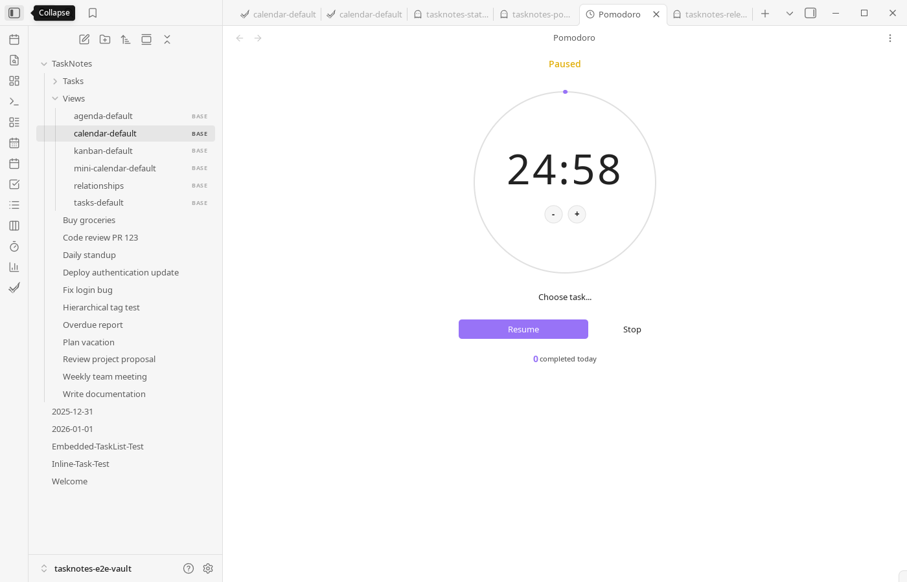

# Pomodoro View

The Pomodoro View provides a timer for working in focused intervals, based on the Pomodoro Technique.

## Timer Interface

The Pomodoro View includes a timer with controls to start, stop, and reset the timer. While a timer is running, the view shows both the remaining duration and the projected local finish time. You can also associate a task with the timer, and the time will be automatically recorded in the task's time tracking data when the session is complete.

## Recent sessions

Below the timer, the view shows how many Pomodoros you completed today. Expand **Recent sessions** to see your last ten work sessions with their start time, length and task. Interrupted sessions are marked.

To remove a session, select the delete button on its row and confirm. With a mouse, the button appears when you point at the row. Deleting a session removes it from your Pomodoro history; it does not change the task's time entries.

Pomodoro history is stored in your daily notes or in plugin data, depending on **Pomodoro data storage**. For totals by day and month, run **TaskNotes: Open Pomodoro statistics**. See [Recorded data](../features/time-management.md#recorded-data).
