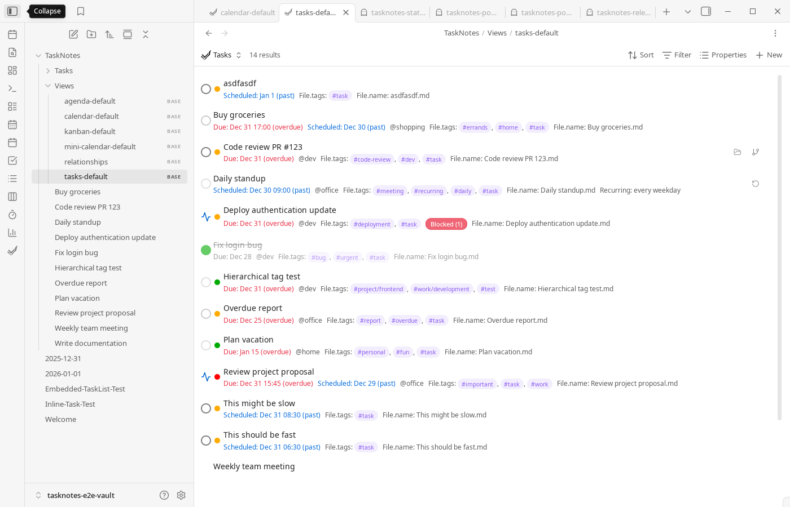

# Task List View


The Task List View displays tasks in a scrollable list format with filtering, sorting, and grouping capabilities. In TaskNotes v4, this view operates as a Bases view configured through YAML.
This view is optimized for high task volume and explicit filter definitions.



## Bases Architecture

Task List is implemented as a `.base` file located in `TaskNotes/Views/tasks-default.base` by default. It requires the Bases core plugin to be enabled.

### What is Bases?

Bases is an official Obsidian core plugin built directly into Obsidian (not a community plugin). It provides a framework for creating database views of notes and tasks.

To enable Bases:
1. Open `Settings -> Core Plugins`
2. Enable "Bases"
3. TaskNotes view commands will now open `.base` files from `TaskNotes/Views/`
If commands open empty or unexpected views, first confirm Bases is enabled and the command path points to the intended `.base` file.

### View File Location

When you use the "Open Tasks View" command or ribbon icon, TaskNotes opens the `.base` file configured under `Settings -> TaskNotes -> General -> Views & base files` (initially `TaskNotes/Views/tasks-default.base`). TaskNotes creates missing default `.base` files automatically on startup when **Auto-create default files** is enabled, and you can point the command to any other `.base` file if you maintain multiple task-list layouts.

## Configuration

Task List views are configured through YAML frontmatter in the `.base` file. The YAML defines which tasks to show, how to sort them, and how to group them.

### Basic Structure

```yaml
# All Tasks

views:
  - type: tasknotesTaskList
    name: "All Tasks"
    order:
      - note.status
      - note.priority
      - note.due
      - note.scheduled
      - note.projects
      - note.contexts
      - file.tags
    sort:
      - column: due
        direction: ASC
```

### Configuration Options

**`type`**: Must be `tasknotesTaskList` for Task List views

**`name`**: Display name shown in the view header

**`order`**: Array of property names that control which task properties are visible in the task cards. Properties are referenced using their Bases property paths (e.g., `note.status`, `note.priority`, `note.due`, `file.tasks`).
For existing `.base` files, add `file.tasks` in YAML manually; once present in `order`, it appears in the Bases picker as `tasks`.

**`sort`**: Array of sort criteria. Tasks are sorted by the first criterion, with ties broken by subsequent criteria.
- `column`: Property to sort by (e.g., `due`, `scheduled`, `priority`, `title`)
- `direction`: `ASC` (ascending) or `DESC` (descending)

**`groupBy`**: Optional grouping configuration
- `property`: Property to group by (e.g., `note.status`, `note.priority`)
- `direction`: Sort direction for group headers

**`hideTopLevelSubtasks`**: Optional boolean. When `true`, tasks whose Projects field links to another task in the current filtered result set are hidden as top-level rows and remain available through the parent task's expanded subtasks.

**`filters`**: Optional filter conditions using Bases query syntax
```yaml
filters:
  and:
    - note.status == "Open"
    - note.priority == "High"
```
Start with one or two simple filters, verify results, then layer complexity. Incremental edits are much easier to debug than large one-shot query rewrites.

### Property Mapping

TaskNotes properties are accessed in Bases YAML using these paths:

| TaskNotes Property | Bases Property Path | Description |
|-------------------|-------------------|-------------|
| Status | `note.status` | Task status value |
| Priority | `note.priority` | Priority level |
| Due date | `note.due` | Due date/time |
| Scheduled date | `note.scheduled` | Scheduled date/time |
| Projects | `note.projects` | Associated projects |
| Contexts | `note.contexts` | Task contexts |
| Tags | `file.tags` | File tags |
| Checklist progress | `file.tasks` | First-level markdown checkbox progress shown as the TaskNotes checklist progress bar |
| Time estimate | `note.timeEstimate` | Estimated duration |
| Recurrence | `note.recurrence` | Recurrence pattern |
| Blocked by | `note.blockedBy` | Blocking dependencies |
| Title | `file.name` | Task title (file name) |
| Created | `file.ctime` | File creation date |
| Modified | `file.mtime` | File modification date |

The exact property names depend on your TaskNotes field mapping settings (`Settings -> TaskNotes -> Task Properties`). The table above shows default mappings.

## Filtering and Sorting

### Adding Filters

Edit the `.base` file to add filter conditions using Bases query syntax:

```yaml
views:
  - type: tasknotesTaskList
    name: "High Priority Tasks"
    filters:
      and:
        - note.priority == "High"
        - note.status != "Completed"
    order:
      - note.status
      - note.priority
      - note.due
```

### Filter Operators

Bases supports standard comparison operators:
- `==` (equals), `!=` (not equals)
- `>`, `<`, `>=`, `<=` (comparison)
- `contains()` (substring/array membership)
- Boolean logic: `and`, `or`

For detailed filter syntax, see the [Bases documentation](https://help.obsidian.md/Plugins/Bases).

### Sorting Examples

Single sort criterion:
```yaml
sort:
  - column: due
    direction: ASC
```

Multiple sort criteria:
```yaml
sort:
  - column: priority
    direction: DESC
  - column: due
    direction: ASC
  - column: title
    direction: ASC
```

### Moving Between Groups

Drag a task into another group or subgroup to update its grouping properties. This works with any active sort, including due date and priority sorting; a move does not change the task's manual rank.

- Dropping on a task or subgroup header applies both destination values where needed.
- Dropping on a primary group header changes only the primary property. It does not assign a subgroup value.
- A highlighted destination previews the properties that will change. An insertion line means manual reordering instead.
- Collapsed headers remain drop targets. While dragging, **Other destinations** offers configured empty status/priority groups and an empty value.
- Use the **Move task** handle to open a destination menu without dragging. When the view is sorted by manual order, the menu also offers **Move up** and **Move down** within the current group. On touch screens, tap the handle for the menu, or drag from it so ordinary row gestures remain available for scrolling. A touch move only applies after the handle has actually moved; lifting your finger in place does nothing.
- Press Escape, or release the task back on its own row, to cancel. Holding a dragged task near the view's top or bottom edge scrolls the list.
- Grouping by a list property such as contexts, projects, or tags groups by the whole list. Moving a task to another such group replaces its list with that group's values, and the preview shows the values before and after, for example `contexts: work, call → home, focus`. If a group's values cannot be determined from its notes' properties (for example, a tag group that only comes from inline tags), the move is blocked rather than guessed.

Formula groups, computed file properties, and TaskNotes-managed manual-order and modified-date fields cannot be assigned by a group move. If a drop would assign a different read-only value, the whole move is blocked rather than changing just one of its properties. Changing a writable property may still naturally recalculate a formula or update the modified date.

After a property move, **Undo** is available briefly. It restores only fields changed by that move and preserves unrelated later edits. If a moved field has since changed, Undo refuses to overwrite it. Manual reordering and recurring-task status changes do not currently offer this Undo action; recurring status changes can affect multiple occurrence notes.

### Assigning a Parent Task

While dragging, each task row shows a separate **Add as subtask** target. Drop on this labeled target to add that task as a parent. Dropping elsewhere on the row keeps the group-movement or manual-reordering behavior above.

Parent assignment adds a link to the dragged task's projects property. It preserves existing project memberships, status, priority, and manual rank, even when the parent is in a different group. This also works in ungrouped lists and views grouped by read-only properties.

The preview names the parent before release. Self-assignment and assignments under a descendant are blocked; existing links are recognized even when they use aliases or Markdown format. Relationships are checked again against file contents when saving. **Undo** removes the assignment while preserving unrelated edits, but refuses if the projects property has since changed.

For keyboard or non-drag use, open **Move task**, select **Add as subtask of…**, and choose an existing task. You can cancel the drag or selector without changing the note.

### Drag-to-Reorder

Task List supports drag-to-reorder when the view is sorted by the manual-order property. With the default field mapping, that property is `tasknotes_manual_order`.

To enable persistent manual ordering in a Task List view:

```yaml
sort:
  - column: tasknotes_manual_order
    direction: DESC
```

Once the first sort criterion is the manual-order property, you can drag task cards to reorder them. TaskNotes writes updated LexoRank-style values into task frontmatter so the order persists across refreshes and sessions.

If your field mapping changes the sort-order property name, use that mapped property name instead of `tasknotes_manual_order`.

### Drag-to-Reorder with Grouping

Grouped Task List views can also be reordered, but the reorder scope is the current group and subgroup. For example, when grouping by status and subgrouping by priority, dragging within "In Progress / High" updates manual order only within that destination.

Important constraints:

- Drag-to-reorder only works when the view sort includes the manual-order property.
- Reordering within the same formula-based destination is allowed when manual ordering is active. Assigning a different formula group is blocked.
- In filtered or partially visible lists, TaskNotes may also update hidden or filtered notes in the same reorder scope to preserve a stable persistent order.
- Large reorder operations may show a confirmation dialog before writing changes.

The default generated TaskNotes task-list templates include a **Manual Order** view that is already configured for this behavior.

## Grouping

Groups organize tasks under collapsible headers based on a property value.

### Enable Grouping

Add `groupBy` configuration to your view:

```yaml
views:
  - type: tasknotesTaskList
    name: "Tasks by Status"
    groupBy:
      property: note.status
      direction: ASC
    order:
      - note.status
      - note.priority
      - note.due
```

### Available Grouping Properties

Common grouping properties:
- `note.status` - Group by task status
- `note.priority` - Group by priority level
- `note.contexts` - Group by first context
- `note.projects` - Group by project (tasks can appear in multiple groups)

### Interactive Group Headers

Group headers support interaction:
- Click to expand/collapse the group
- Click on project links in headers to navigate to project notes
- Hover over project links with Ctrl to preview project notes

### Collapsed State Persistence

Collapsed/expanded state for each group is preserved across sessions.

## Creating Multiple Views

You can create multiple `.base` files for different task perspectives:

1. Duplicate an existing `.base` file in `TaskNotes/Views/`
2. Rename it (e.g., `High Priority.base`)
3. Edit the YAML configuration for that view
4. Open the file to see the customized view

### Example: Context-Specific View

```yaml
# Work Tasks

views:
  - type: tasknotesTaskList
    name: "Work Context"
    filters:
      and:
        - note.contexts.contains("work")
    groupBy:
      property: note.priority
      direction: DESC
    order:
      - note.status
      - note.priority
      - note.due
```

## Migrating from v3 Saved Views

TaskNotes v3 stored filter configurations in plugin settings. These saved views are **not automatically migrated** to v4.

To recreate a v3 saved view:
1. Create a new `.base` file in `TaskNotes/Views/`
2. Translate your v3 filter conditions to Bases YAML syntax
3. Configure sorting and grouping through YAML
4. Save the file

The v3 FilterBar UI component no longer exists - all configuration is done through YAML editing.

## Task Actions

The Task List View provides interaction with tasks through clicking and context menus:

- **Click on a task**: Opens the task for editing or navigates to the task note (behavior configured in `Settings -> TaskNotes -> General` in click-action controls)
- **Right-click on a task**: Opens a context menu with actions:
  - Mark as complete
  - Change priority
  - Change status
  - Edit dates
  - Delete task
  - And more

Context menu availability depends on your TaskNotes settings and task properties.

## Virtual Scrolling

The Task List View automatically enables virtual scrolling when displaying 100 or more items (tasks + group headers). Virtual scrolling provides:

- Approximately 90% memory reduction for large lists
- Elimination of UI lag when scrolling through hundreds of tasks
- Smooth performance with unlimited task counts

Virtual scrolling activates automatically and requires no configuration. When active, only visible tasks are rendered to the DOM, with off-screen tasks rendered on-demand as you scroll.

## Further Reading

- [Default Base Templates](default-base-templates.md) - Complete templates for all TaskNotes views
- [Bases Plugin Documentation](https://help.obsidian.md/Plugins/Bases) - Official Obsidian documentation for Bases syntax and features
- [Kanban View](kanban-view.md) - Alternative board-based task visualization
- [Calendar Views](calendar-views.md) - Time-based task visualization
- [Views Overview](../views.md) - All available TaskNotes views
